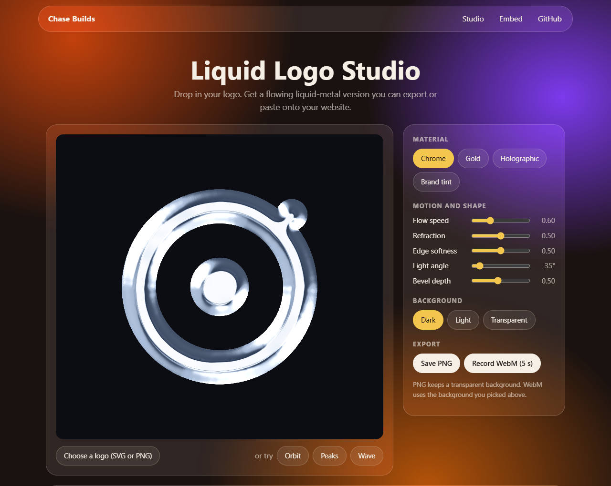

# Liquid Logo Studio

[](https://github.com/chasebuilds/liquid-logo-studio/actions/workflows/ci.yml)

Turn your logo into flowing liquid chrome, gold or holographic metal. Drop in an SVG or PNG, pick a look, then save it as an image or video, or paste two lines onto your website so the logo moves there too.

**Live demo: https://chasebuilds.github.io/liquid-logo-studio/**



## What you get

- **Four looks:** chrome, gold, holographic, or a tint of your brand color.
- **Sliders:** flow speed, refraction, edge softness, light angle, bevel depth.
- **Reacts to the mouse:** move over the logo and ripples spread through the metal.
- **Export:** a transparent PNG, or a 5 second WebM video.
- **Runs in the browser:** your logo is never uploaded anywhere.
- **Polite by default:** people who set "reduce motion" see a still frame, the animation pauses when the tab is hidden or scrolled off screen, and browsers without WebGL2 get your plain logo.

## Put it on your website

Copy the snippet the studio shows under "Put it on your website". It looks like this:

```html
<script src="https://chasebuilds.github.io/liquid-logo-studio/liquid-logo.js" defer></script>
<div data-liquid-logo data-src="your-logo.svg" data-preset="chrome"
     data-speed="0.6" data-refraction="0.5" data-softness="0.5"
     data-light="35" data-bevel="0.5" style="width:320px"></div>
```

Replace `your-logo.svg` with your own logo file. For a faster page, download `liquid-logo.js` and host it next to your logo (it is one file, about 8 KB gzipped, no other dependencies).

Settings are plain attributes: `data-preset` (`chrome`, `gold`, `holographic`, `tint`), `data-tint` (a color like `#3b82f6`, used with `tint`), `data-speed` (0 to 2), `data-refraction`, `data-softness`, `data-bevel` (0.1 to 1) and `data-light` (0 to 360 degrees). The element's width sets the size. For scripts, `LiquidLogo.init()` mounts any elements added later.

## Run it locally

```sh
npm install
npm run serve      # then open the address it prints
npm run lint
npm test           # unit tests plus a headless Chromium check of the real shader
```

## How it works

1. The logo is drawn to a canvas and its shape becomes a mask.
2. A distance transform (in `liquid-logo.js`) measures how far every pixel is from the edge. That gives a smooth bevel profile.
3. A WebGL2 fragment shader treats that profile as the height of a liquid surface, adds slow flowing noise and mouse ripples, works out the surface angle at each pixel, and looks up what a made-up studio (bright horizon, two soft boxes) would reflect.
4. That reflection is colored by the chosen material.

The shader and the mask code are written from scratch for this project. The idea of a liquid-metal logo effect comes from the Paper Design liquid-logo shader, which was studied for inspiration only; no code, shader or asset was copied.

## Sample logos

`samples/` has three simple shapes made for this repo (orbit, peaks, wave). They are not anyone's brand.

## Limits

- Needs WebGL2 (all current Chrome, Edge, Firefox and Safari). Without it the plain logo shows.
- Only the logo's shape is used: colors inside the SVG or PNG are ignored. Brand tint takes its color from the picker.
- Very thin strokes get little bevel; raise the bevel slider or thicken the shape.
- WebM recording needs a browser with MediaRecorder. Safari support varies; PNG export works everywhere.
- Keep the logo file on the same domain as the page that embeds it; a logo from another domain is blocked by the browser unless that site allows cross-origin access.

## License

MIT, Chase Builds.

## More from Chase Builds

- **[notebook-shelf](https://github.com/chasebuilds/notebook-shelf)**: A shelf of notebooks that open in 3D. Great for portfolios, menus and catalogs. ([live demo](https://chasebuilds.github.io/notebook-shelf/))
- **[r3f-showcase](https://github.com/chasebuilds/r3f-showcase)**: 3D product configurator, scroll hero and gallery wall for a business site. ([live demo](https://chasebuilds.github.io/r3f-showcase/))
- **[dither-pond](https://github.com/chasebuilds/dither-pond)**: A stylized 3D scene with a day-to-night slider and a mix of animals, boat, bike, wind and water. ([live demo](https://chasebuilds.github.io/dither-pond/))

[All projects, sorted by industry](https://github.com/chasebuilds) · [chasebuilds.github.io](https://chasebuilds.github.io)
